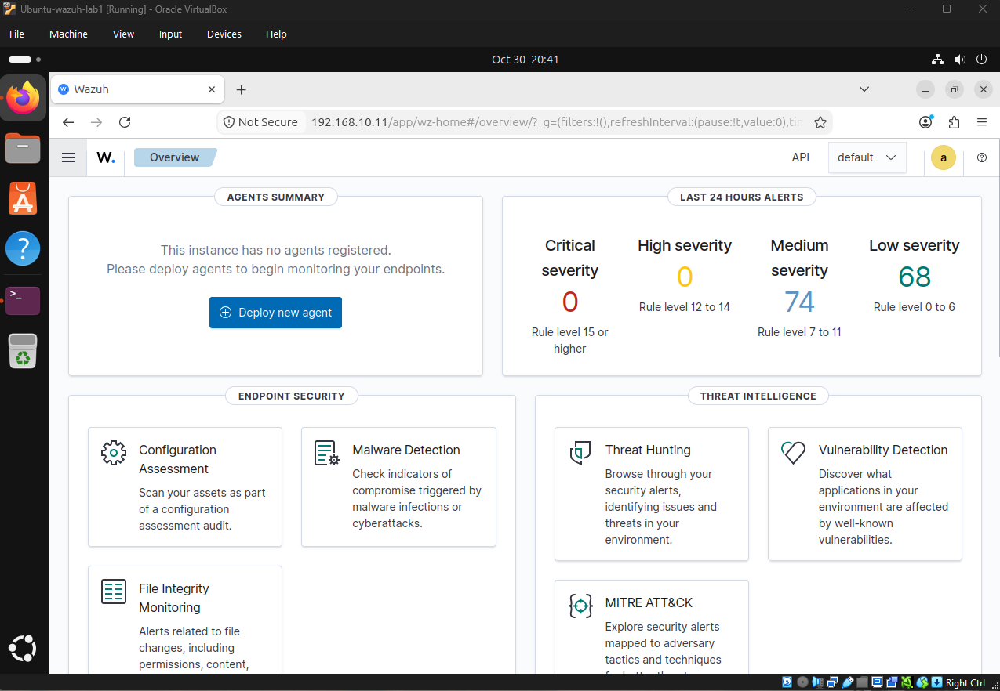
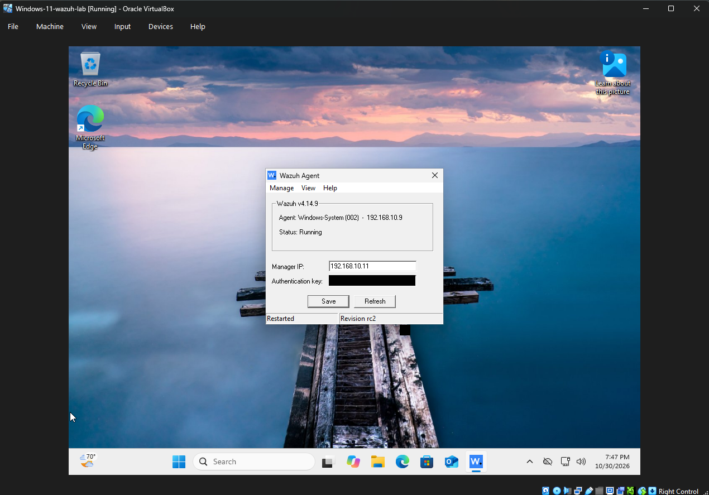
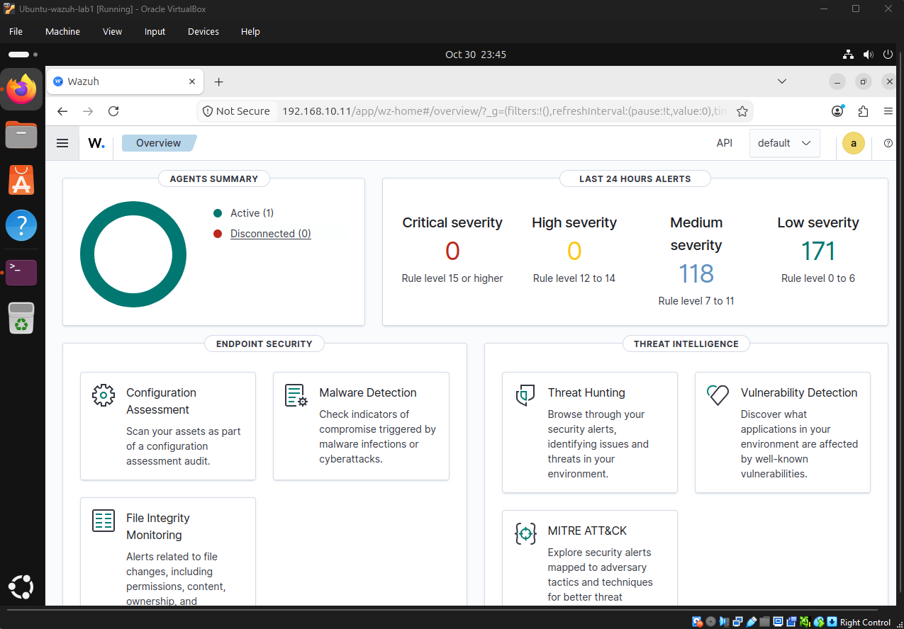
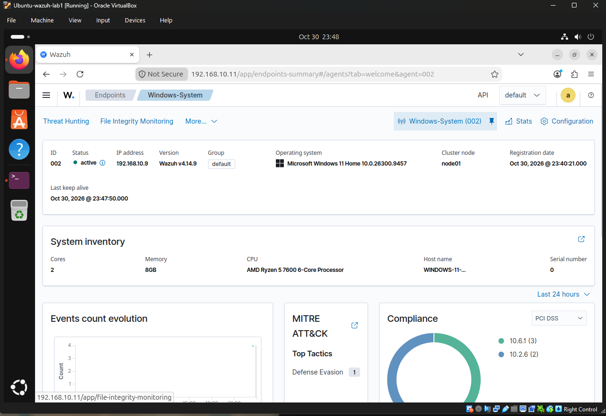
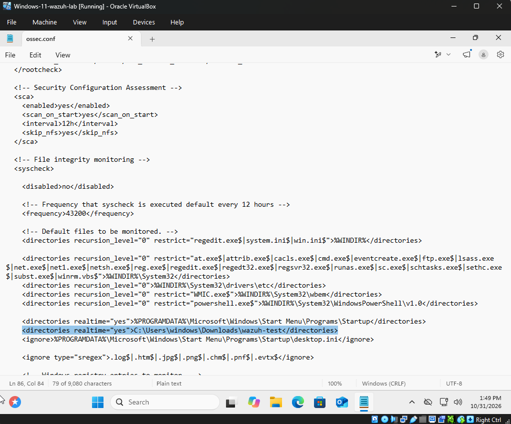
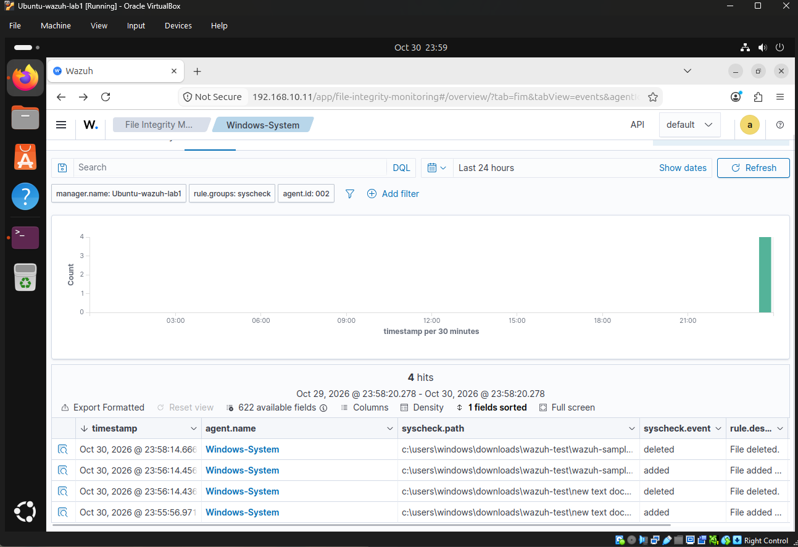
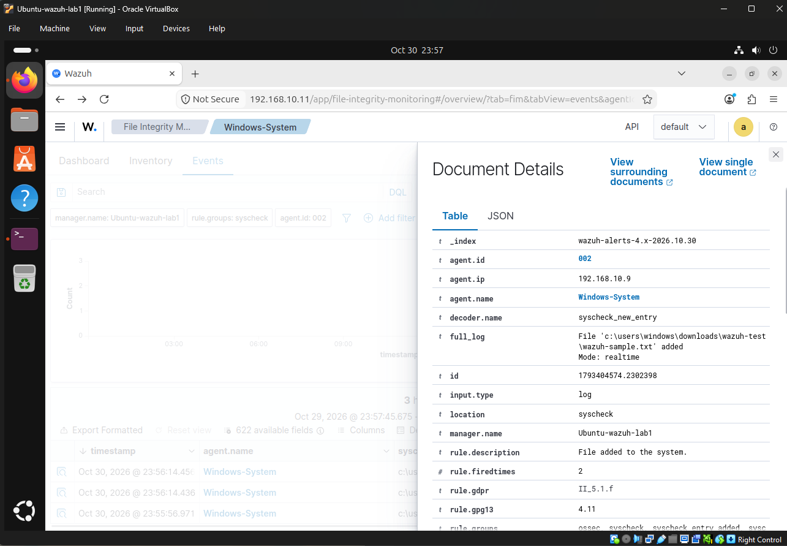
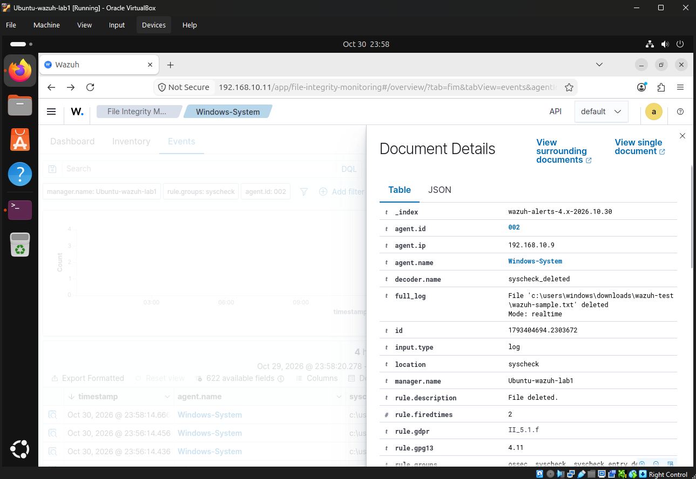

# Wazuh SIEM Home Lab
A home lab using Wazuh SIEM for security monitoring and File Integrity Monitoring (FIM).

## Objective
Built a two-VM home lab using Wazuh to practice endpoint monitoring.

## Environment
- Oracle VirtualBox running on Windows PC
- Ubuntu Desktop 24.04 – Wazuh Manager (192.168.10.11)
- Windows 11 – Wazuh Agent (192.168.10.9)

## Implementation
- Installed and configured the Wazuh Manager and dashboard on the Ubuntu system.
- Installed the Wazuh agent on the Windows machine and registered it with the manager.
- Confirmed the agent showed as Active in the dashboard.
- Edited the agent's `ossec.conf` file to monitor a test folder with `realtime="yes"`.
- Added and deleted test files in the test folder, and then confirmed alerts were generated on Wazuh.

## Results
- The Windows agent was enrolled successfully and showed as **Active**.
- Wazuh FIM detected file **added** and **deleted** events in the monitored folder within seconds.
- Generated alerts after creating and deleting the test files.

## Screenshots

### 1. Before: no agents registered

### 2. Windows agent configured

### 3. After: agent active

### 4. Agent details

### 5. FIM configuration

### 6. FIM events

### 7. File added alert

### 8. File deleted alert

